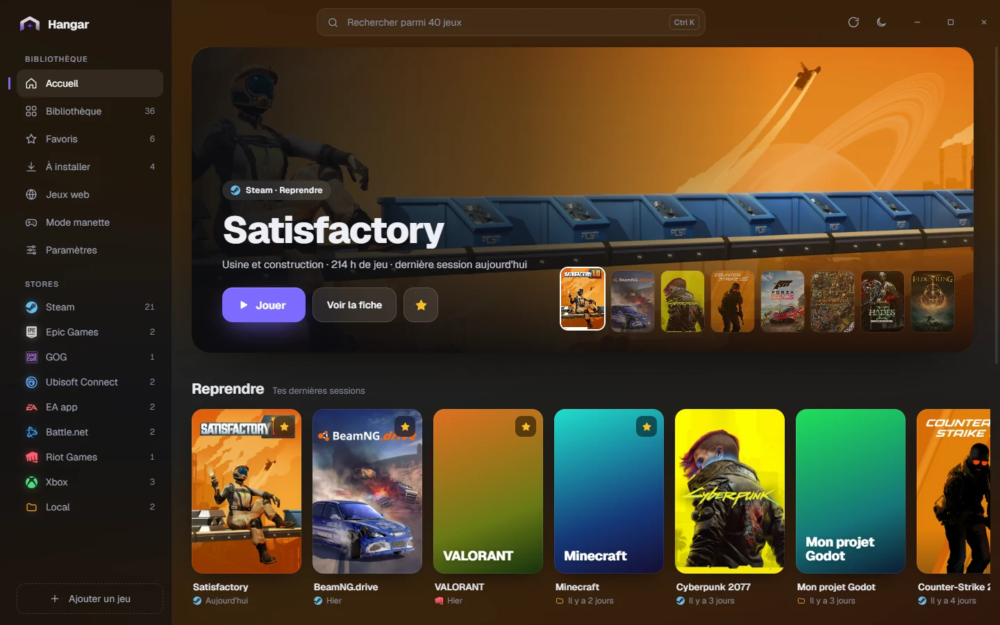
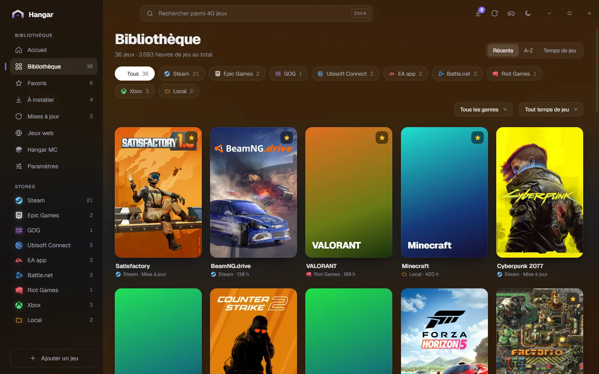
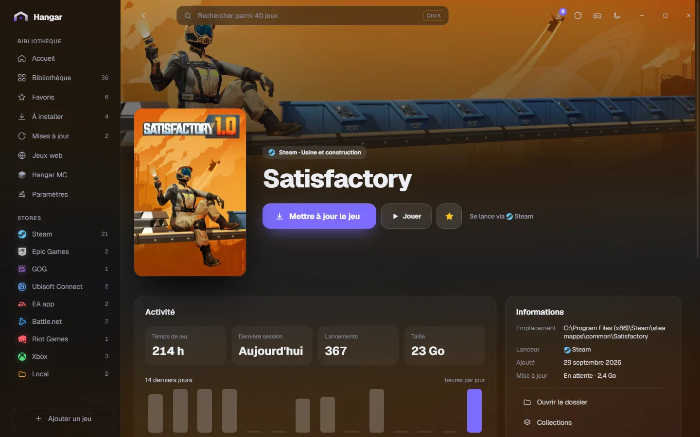
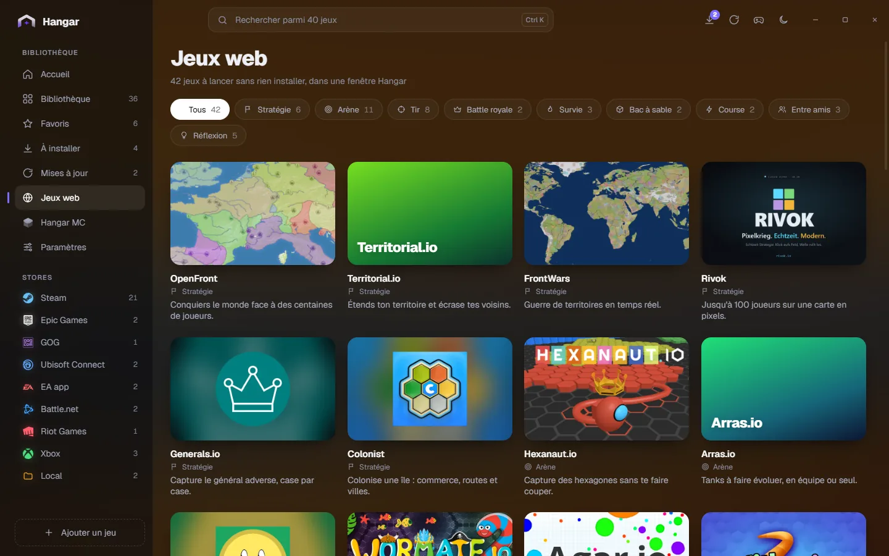

<div align="center">

# Hangar

**Tous tes jeux, un seul launcher.** Pour Windows 10/11 et macOS. La version Linux est en pause (en cours de refonte).

Hangar trouve tout seul les jeux de ton ordinateur (Steam, Epic, GOG, Ubisoft Connect, EA app, Battle.net, Riot, Xbox...), les affiche avec leurs vraies jaquettes et les lance en un clic. Les jeux que tu possèdes sans les avoir installés sont là aussi, prêts à installer.

### [⬇ Télécharger Hangar](https://github.com/maelpasq/hangar/releases/latest)

[Licence MIT](LICENSE)

</div>



## Ce que fait Hangar

- **Détection automatique** de tous tes jeux, quel que soit le store, plus tes dossiers de jeux et les jeux que tu ajoutes à la main.
- **Jeux à installer** : les jeux de tes launchers qui ne sont pas sur cet ordinateur ont leur onglet « À installer » ; Hangar te demande dans quel dossier de leur launcher les installer, avec la place libre de chaque disque. Les jeux Steam se téléchargent en arrière-plan, avec la progression dans Hangar. Relie tes comptes Steam, GOG ou Epic pour retrouver toute ta bibliothèque. Sous Linux, le filtre « Compatibles Linux » ne garde que les jeux qui y tournent (version Linux, ou Vérifié / Jouable sur Steam Deck).
- **Vraies jaquettes et bannières**, trouvées automatiquement (Steam, stores, SteamGridDB) et gardées en cache.
- **Lancement en un clic**, via le launcher du jeu ou directement son exécutable. Sous Windows, les launchers restent cachés en arrière-plan : tu ne vois que ton jeu.
- **Désinstaller** depuis Hangar, après confirmation : les jeux Steam, Epic et GOG sont supprimés sans ouvrir leur launcher.
- **Mises à jour des jeux** : Hangar repère les jeux Steam, Epic et GOG qui attendent une mise à jour, les range dans un onglet « Mises à jour » et te prévient par une notification. « Mettre à jour » la lance en arrière-plan dans le bon launcher, sans afficher sa fenêtre. Le menu Mises à jour (icône en haut) montre les installations et mises à jour Steam en cours avec leur vraie progression, même après un redémarrage de Hangar, et « Afficher dans Steam » permet de les mettre en pause ou de les annuler.
- **Mode manette** : Hangar en plein écran, à jouer depuis le canapé (bouton Start pour l'ouvrir, A pour jouer).
- **Suivi du temps de jeu** : Hangar chronomètre chaque session, affiche la dernière partie, le nombre de lancements et l'activité des 14 derniers jours.
- **Collections et filtres** : range tes jeux dans tes propres listes et filtre par store, genre ou temps de jeu. Recherche instantanée (`Ctrl K` / `⌘ K`), favoris, tri, jeux masqués, thème clair ou sombre, couleur d'accent.
- **Toujours à portée** : tes jeux récents dans la zone de notification (barre des menus sous macOS), et `Ctrl+Alt+H` pour afficher ou cacher Hangar.
- **Jeux web** : un onglet de jeux navigateur connus (.io et classiques), à lancer sans rien installer.
- **Discord** : tes amis voient à quoi tu joues, avec la jaquette du jeu et ton temps de jeu (à activer dans **Paramètres > Général**).
- **Prêt en quatre étapes** : à la première ouverture, un assistant règle tes launchers, tes dossiers de jeux, ta couleur et les jeux web. Tu peux le relancer depuis **Paramètres > Général**.
- **Mises à jour de Hangar intégrées** : quand une nouvelle version sort, un bouton « Mettre à jour Hangar » apparaît dans l'app.







## Installer

Va sur la **[page des releases](https://github.com/maelpasq/hangar/releases/latest)** et télécharge le fichier de ton système :

| Système | Fichier |
|---|---|
| Windows 10/11 | `Hangar-Setup.exe` |
| macOS (Intel et Apple Silicon) | `Hangar_x.y.z_universal.dmg` |

Les autres fichiers de la release servent aux mises à jour automatiques, tu n'en as pas besoin.

### Windows

Lance `Hangar-Setup.exe`, puis clique sur **Installer**. L'installation se fait dans ton compte, sans droits administrateur.

Si Windows affiche « Windows a protégé votre ordinateur », clique sur **Informations complémentaires** puis **Exécuter quand même**. Ce message apparaît pour toutes les apps qui ne sont pas signées par un certificat payant.

### macOS

Ouvre le `.dmg` et glisse **Hangar** dans **Applications**.

Hangar n'est pas signé par Apple. Au premier lancement, macOS peut dire que l'app est « endommagée » ou d'un « développeur non identifié ». Ouvre le Terminal et lance une seule fois :

```bash
xattr -cr /Applications/Hangar.app
```

Tu peux aussi passer par **Réglages Système > Confidentialité et sécurité > Ouvrir quand même**. Les mises à jour suivantes se font depuis Hangar, sans rien refaire.

### Linux

La version Linux est en pause : elle avait trop de bugs et sera refaite. Elle n'est plus proposée au téléchargement. Une AppImage déjà installée n'affiche plus qu'un écran d'attente et recevra la nouvelle version Linux par mise à jour quand elle sera prête.

## ⚠ Indispensable : ta clé SteamGridDB

Sans clé SteamGridDB, beaucoup de jeux (ceux qui ne sont pas sur Steam : Epic, Riot, jeux locaux...) restent sans jaquette. La clé est gratuite et prend deux minutes :

1. Crée un compte sur **[steamgriddb.com](https://www.steamgriddb.com)** (connexion avec Steam possible).
2. Va dans **[Préférences > API](https://www.steamgriddb.com/profile/preferences/api)** et génère ta clé.
3. Dans Hangar, ouvre **Paramètres > Jaquettes**, colle la clé dans **Clé API SteamGridDB** puis clique sur **Enregistrer**.

Hangar recherche alors les jaquettes et bannières manquantes. La clé reste sur ton ordinateur et n'est envoyée qu'à SteamGridDB.

## Jeux détectés

| Store | Windows | macOS | Linux |
|---|---|---|---|
| Steam | ✓ | ✓ | ✓ (Proton compris) |
| Epic Games | ✓ | ✓ | |
| GOG | ✓ | ✓ (jeux installés dans Applications) | |
| Ubisoft Connect | ✓ | | |
| EA app | ✓ | | |
| Battle.net | ✓ | | |
| Riot Games | ✓ | ✓ | |
| Xbox / Microsoft Store | ✓ | | |
| Jeux installés hors store | ✓ (raccourcis et programmes installés) | ✓ (apps de la catégorie Jeux) | ✓ (raccourcis de la catégorie Jeux) |
| Dossiers de jeux locaux | ✓ | ✓ | ✓ |
| Ajout manuel | ✓ | ✓ | ✓ |

Les jeux possédés mais pas installés viennent de Steam, Epic, GOG Galaxy et du Riot Client présents sur l'ordinateur, et des comptes que tu relies dans **Paramètres > Launchers et comptes** (Steam avec ta clé d'API Web, GOG et Epic par leur page de connexion officielle).

Un jeu manque ? Ajoute son dossier dans **Paramètres > Bibliothèque > Dossiers de jeux locaux**, ou utilise **Ajouter un jeu** en bas de la barre latérale.

« Masquer » cache seulement un jeu dans Hangar, sans rien supprimer. Seul « Désinstaller », après ta confirmation, supprime les fichiers du jeu (le dossier connu de son launcher, jamais un dossier système ni ton dossier personnel) ; pour Ubisoft, EA, Battle.net et Riot, il passe la main au launcher du jeu.

Tes données (réglages, favoris, temps de jeu) sont dans `%APPDATA%\studio.pamal.hangar` sous Windows, `~/Library/Application Support/studio.pamal.hangar` sous macOS et `~/.config/studio.pamal.hangar` sous Linux.

## Confidentialité

Hangar ne collecte aucune donnée personnelle et n'a aucune télémétrie. Il ne transfère d'information vers d'autres systèmes en réseau que pour les fonctions suivantes :

- **Jaquettes et infos des jeux** : le nom ou l'identifiant d'un jeu est envoyé à Steam, Epic Games, GOG, au Microsoft Store et, si tu as saisi ta clé, à SteamGridDB, pour récupérer ses images et son genre.
- **Comptes reliés** (seulement si tu en relies un) : Hangar demande la liste de tes jeux à Steam, GOG ou Epic Games, directement auprès de leurs serveurs.
- **Mises à jour des jeux** : Hangar compare la version de tes jeux GOG installés à la liste publique de GOG et, si ton compte Epic est relié, celle de tes jeux Epic à leur dernière version (au plus toutes les 6 heures). Les mises à jour Steam, et celles déjà lancées dans Epic, sont lues sur ton ordinateur.
- **Discord** (seulement si tu l'actives) : le nom et la jaquette de ton jeu passent par l'app Discord installée sur ton ordinateur.
- **Jeux web** : le site d'un jeu n'est contacté que quand tu le lances, dans sa propre fenêtre.
- **Signaler un bug** (bouton insecte, seulement quand tu envoies) : ton titre, ta description, ta capture si tu en joins une, la version de Hangar et ton système partent vers le salon Discord privé du développeur.
- **Mises à jour de Hangar** : Hangar lit le fichier des versions sur GitHub au démarrage, et télécharge la nouvelle version depuis GitHub quand tu cliques sur « Mettre à jour Hangar ».

Ta clé SteamGridDB, ta bibliothèque et ton temps de jeu restent sur ton ordinateur. Les clés et jetons des comptes reliés sont rangés dans le coffre du système (Gestionnaire d'identification Windows, Trousseau macOS, KWallet ou GNOME Keyring sous Linux), jamais dans un fichier.

## Contribuer

Un bug : clique sur l'insecte en haut de Hangar. Une idée, ou un bug à suivre en public : ouvre une [issue](https://github.com/maelpasq/hangar/issues/new/choose). Pour participer au code, lis [CONTRIBUTING.md](CONTRIBUTING.md). Une faille de sécurité se signale en privé, voir [SECURITY.md](SECURITY.md).

---

## Pour les développeurs

Hangar est fait avec [Tauri 2](https://tauri.app) (Rust) et une interface [Svelte 5](https://svelte.dev).

### Prérequis

- [Node.js](https://nodejs.org) 22 ou plus et [Rust](https://rustup.rs) (stable).
- **Windows** : les « Build Tools for Visual Studio » (charge de travail « Développement Desktop en C++ »). WebView2 est déjà présent sur Windows 10/11.
- **macOS** : les outils en ligne de commande Xcode (`xcode-select --install`).
- **Linux** : WebKitGTK 4.1, libayatana-appindicator, librsvg et D-Bus (voir l'étape « Linux, dépendances » de `.github/workflows/build.yml`).

### Récupérer et lancer le projet

```bash
git clone https://github.com/maelpasq/hangar.git
cd hangar
npm install
npm run dev
```

`npm run dev` ouvre l'app avec rechargement à chaud, dans un environnement de test séparé (« Hangar Test ») : il ne touche ni à une Hangar déjà installée, ni à ses données ou ses comptes. `npm run test-env:clean` le supprime. Pour travailler sur l'interface seule dans un navigateur, avec 40 jeux de démo (dont 4 à installer) :

```bash
npm run dev:web
```

### Compiler un installeur

```bash
npm run build
```

L'installeur est créé dans `src-tauri/target/release/bundle/` : `nsis/` (`.exe`) sous Windows, `dmg/` sous macOS, `appimage/` sous Linux.

Sous Windows, l'installeur aux couleurs de Hangar (`installer/`) embarque ce NSIS et se compile ensuite :

```bash
npm run build:setup
```

Il est créé dans `installer/target/release/hangar-setup.exe`. `build.bat` fait tout en un double-clic.

### Vérifier avant de proposer un changement

```bash
npm run check
npm run test
cd src-tauri && cargo test && cargo clippy --all-targets -- -D warnings
```

Le CI (`.github/workflows/build.yml`) relance tout ça sur Windows, macOS et Linux à chaque push.

### Publier une version (mainteneur)

La procédure complète et l'historique des versions sont dans [`docs/RELEASES.md`](docs/RELEASES.md). En bref :

```bash
npm version patch
git push --follow-tags
```

Le workflow `release.yml` construit l'installeur Windows, le `.dmg` macOS universel et l'AppImage Linux, les publie dans une release GitHub et génère `latest.json`, que lit le bouton « Mettre à jour ». Il a besoin des secrets `TAURI_SIGNING_PRIVATE_KEY` (contenu de la clé privée de signature des mises à jour) et `TAURI_SIGNING_PRIVATE_KEY_PASSWORD`. Si cette clé est perdue, les versions installées ne peuvent plus se mettre à jour.

La documentation du projet (spécification, design system, architecture, décisions) est dans [`docs/`](docs). Pour développer avec Claude Code, voir [`CLAUDE.md`](CLAUDE.md).
