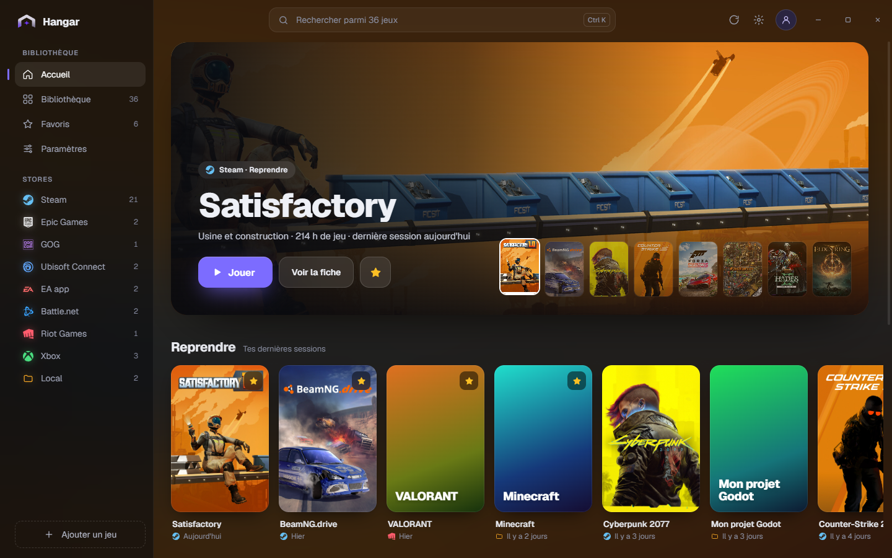
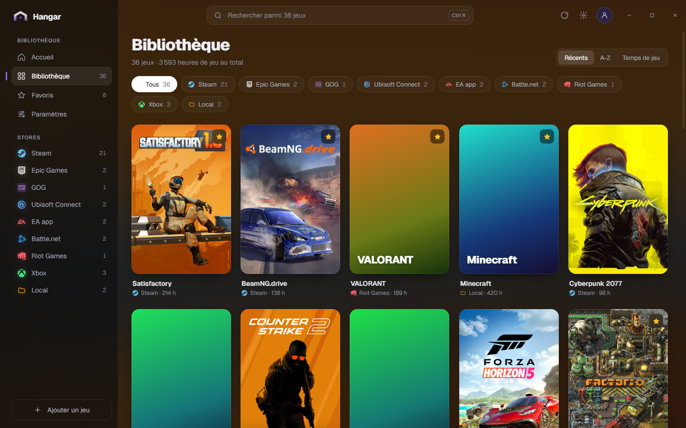
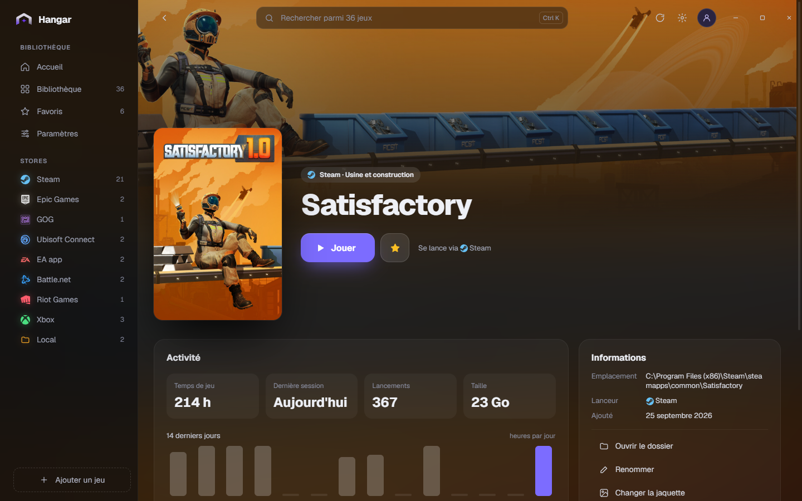

<div align="center">

# Hangar

**Tous tes jeux, un seul launcher.** Pour Windows 10/11 et macOS.

Hangar trouve tout seul les jeux installés sur ton ordinateur (Steam, Epic, GOG, Ubisoft Connect, EA app, Battle.net, Riot, Xbox...), les affiche avec leurs vraies jaquettes et les lance en un clic.

### [⬇ Télécharger Hangar](https://github.com/maelpasq/hangar/releases/latest)

[Code signing policy](#code-signing-policy) · [Licence MIT](LICENSE)

</div>



## Ce que fait Hangar

- **Détection automatique** de tous tes jeux, quel que soit le store, plus tes dossiers de jeux et les jeux que tu ajoutes à la main.
- **Vraies jaquettes et bannières**, trouvées automatiquement (Steam, stores, SteamGridDB) et gardées en cache.
- **Lancement en un clic**, via le launcher du jeu ou directement son exécutable.
- **Suivi du temps de jeu** : Hangar chronomètre chaque session, affiche la dernière partie, le nombre de lancements et l'activité des 14 derniers jours.
- **Recherche instantanée** (`Ctrl K` / `⌘ K`), favoris, tri, filtres par store, jeux masqués, couleur d'accent.
- **Mises à jour intégrées** : quand une nouvelle version sort, un bouton « Mettre à jour » apparaît dans Hangar.





## Installer

Va sur la **[page des releases](https://github.com/maelpasq/hangar/releases/latest)** et télécharge le fichier de ton système :

| Système | Fichier |
|---|---|
| Windows 10/11 | `Hangar_x.y.z_x64-setup.exe` |
| macOS (Intel et Apple Silicon) | `Hangar_x.y.z_universal.dmg` |

Les autres fichiers de la release servent aux mises à jour automatiques, tu n'en as pas besoin.

### Windows

Lance `Hangar_x.y.z_x64-setup.exe`. L'installation se fait dans ton compte, sans droits administrateur.

Si Windows affiche « Windows a protégé votre ordinateur », clique sur **Informations complémentaires** puis **Exécuter quand même**. Ce message apparaît pour toutes les apps qui ne sont pas signées par un certificat payant.

### macOS

Ouvre le `.dmg` et glisse **Hangar** dans **Applications**.

Hangar n'est pas signé par Apple. Au premier lancement, macOS peut dire que l'app est « endommagée » ou d'un « développeur non identifié ». Ouvre le Terminal et lance une seule fois :

```bash
xattr -cr /Applications/Hangar.app
```

Tu peux aussi passer par **Réglages Système > Confidentialité et sécurité > Ouvrir quand même**. Les mises à jour suivantes se font depuis Hangar, sans rien refaire.

## ⚠ Indispensable : ta clé SteamGridDB

Sans clé SteamGridDB, beaucoup de jeux (ceux qui ne sont pas sur Steam : Epic, Riot, jeux locaux...) restent sans jaquette. La clé est gratuite et prend deux minutes :

1. Crée un compte sur **[steamgriddb.com](https://www.steamgriddb.com)** (connexion avec Steam possible).
2. Va dans **[Préférences > API](https://www.steamgriddb.com/profile/preferences/api)** et génère ta clé.
3. Dans Hangar, ouvre **Paramètres**, colle la clé dans **Clé API SteamGridDB** puis clique sur **Enregistrer**.

Hangar recherche alors les jaquettes et bannières manquantes. La clé reste sur ton ordinateur et n'est envoyée qu'à SteamGridDB.

## Jeux détectés

| Store | Windows | macOS |
|---|---|---|
| Steam | ✓ | ✓ |
| Epic Games | ✓ | ✓ |
| GOG | ✓ | ✓ (jeux installés dans Applications) |
| Ubisoft Connect | ✓ | |
| EA app | ✓ | |
| Battle.net | ✓ | |
| Riot Games | ✓ | ✓ |
| Xbox / Microsoft Store | ✓ | |
| Jeux installés hors store | ✓ (raccourcis et programmes installés) | ✓ (apps de la catégorie Jeux) |
| Dossiers de jeux locaux | ✓ | ✓ |
| Ajout manuel | ✓ | ✓ |

Un jeu manque ? Ajoute son dossier dans **Paramètres > Dossiers de jeux locaux**, ou utilise **Ajouter un jeu** en bas de la barre latérale.

Hangar ne supprime jamais rien : « Masquer » cache seulement un jeu dans Hangar. Il ne contacte que les sources d'images des jeux et GitHub pour les mises à jour, sans aucune télémétrie.

Tes données (réglages, favoris, temps de jeu) sont dans `%APPDATA%\studio.pamal.hangar` sous Windows et `~/Library/Application Support/studio.pamal.hangar` sous macOS.

## Code signing policy

Free code signing provided by [SignPath.io](https://about.signpath.io), certificate by [SignPath Foundation](https://signpath.org).

Seuls les binaires construits par le workflow GitHub Actions de ce dépôt, à partir de son code source, sont signés. Chaque release est approuvée à la main avant signature.

- Committers et reviewers : [maelpasq](https://github.com/maelpasq)
- Approvers : [maelpasq](https://github.com/maelpasq)

### Confidentialité

Hangar ne collecte aucune donnée personnelle et n'a aucune télémétrie. Il ne transfère d'information vers d'autres systèmes en réseau que pour les fonctions suivantes :

- **Jaquettes et infos des jeux** : le nom ou l'identifiant d'un jeu est envoyé à Steam, Epic Games, GOG, au Microsoft Store et, si tu as saisi ta clé, à SteamGridDB, pour récupérer ses images et son genre.
- **Mises à jour** : Hangar lit le fichier des versions sur GitHub au démarrage, et télécharge la nouvelle version depuis GitHub quand tu cliques sur « Mettre à jour ».

Ta clé SteamGridDB, ta bibliothèque et ton temps de jeu restent sur ton ordinateur.

---

## Pour les développeurs

Hangar est fait avec [Tauri 2](https://tauri.app) (Rust) et une interface [Svelte 5](https://svelte.dev).

### Prérequis

- [Node.js](https://nodejs.org) 22 ou plus et [Rust](https://rustup.rs) (stable).
- **Windows** : les « Build Tools for Visual Studio » (charge de travail « Développement Desktop en C++ »). WebView2 est déjà présent sur Windows 10/11.
- **macOS** : les outils en ligne de commande Xcode (`xcode-select --install`).

### Récupérer et lancer le projet

```bash
git clone https://github.com/maelpasq/hangar.git
cd hangar
npm install
npm run dev
```

`npm run dev` ouvre l'app avec rechargement à chaud. Pour travailler sur l'interface seule dans un navigateur, avec 36 jeux de démo :

```bash
npm run dev:web
```

### Compiler un installeur

```bash
npm run build
```

L'installeur est créé dans `src-tauri/target/release/bundle/` : `nsis/` (`.exe`) sous Windows, `dmg/` sous macOS. Sous Windows, `build.bat` fait tout en un double-clic.

### Vérifier avant de proposer un changement

```bash
npm run check
npm run test
cd src-tauri && cargo test && cargo clippy --all-targets -- -D warnings
```

Le CI (`.github/workflows/build.yml`) relance tout ça sur Windows et macOS à chaque push.

### Publier une version (mainteneur)

```bash
npm version patch
git push --follow-tags
```

Le workflow `release.yml` construit l'installeur Windows et le `.dmg` macOS universel, les publie dans une release GitHub et génère `latest.json`, que lit le bouton « Mettre à jour ». Il a besoin du secret `TAURI_SIGNING_PRIVATE_KEY` (contenu de la clé privée de signature des mises à jour). Si cette clé est perdue, les versions installées ne peuvent plus se mettre à jour.

La documentation du projet (spécification, design system, architecture, décisions) est dans [`docs/`](docs). Pour développer avec Claude Code, voir [`CLAUDE.md`](CLAUDE.md).
